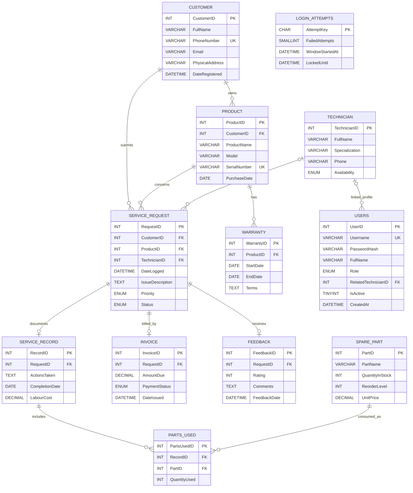

# ASSIS Database Documentation

This is the as-built database reference generated from [`database/schema.sql`](./database/schema.sql). The schema file is authoritative if this document and the DDL ever differ.

## Database overview

- Database: `assis_db`
- Engine: InnoDB
- Character set and collation: `utf8mb4` / `utf8mb4_unicode_ci`
- Tables: 12, including the application authentication table `USERS` and login throttling table `LOGIN_ATTEMPTS`
- Monetary values use `DECIMAL(10,2)`; the application displays them in KES.

## Entity-relationship diagram

In the diagram, `PK` and `FK` mark primary and foreign keys; optional foreign-key participation is shown with a circle. `SERVICE_RECORD.RequestID`, `INVOICE.RequestID`, and `FEEDBACK.RequestID` are unique, giving each request zero or one related row in those tables. `USERS.RelatedTechnicianID` is nullable and not unique, so a user may have no linked specialist profile and a technician profile may be linked to multiple user rows at the database level. Application account creation applies the stricter technician-link rule.

## Table descriptions

| Table | Purpose |
|---|---|
| `CUSTOMER` | Contact details and registration date for each customer. |
| `PRODUCT` | Customer-owned equipment, identified by a unique serial number. |
| `WARRANTY` | Warranty dates and terms for a product. The schema allows multiple warranty rows per product. |
| `TECHNICIAN` | Technician identity, specialization, contact number, and current availability. |
| `USERS` | Login credentials, role, activation flag, and optional link to a technician profile. |
| `LOGIN_ATTEMPTS` | Hashed username/IP throttling buckets, failed-attempt count, active window, and lock expiry; contains no foreign-key relationship to user records. |
| `SERVICE_REQUEST` | Customer/product repair ticket, its current technician assignment, priority, current status, and logged date. |
| `SERVICE_RECORD` | Repair actions, completion date, and labour cost for a request. At most one record is allowed per request. |
| `SPARE_PART` | Part catalogue, stock quantity, reorder threshold, and unit selling price. |
| `PARTS_USED` | Associative rows recording which parts and quantities were used in a service record. |
| `INVOICE` | Amount due, payment status, and issue date for a request. At most one invoice is allowed per request. |
| `FEEDBACK` | One optional rating and comment record per request. |

## Data dictionary

`NOT NULL` means required. `NULL` means optional. Defaults and allowed values are specified exactly as defined in the DDL. `SERVICE_RECORD.RequestID`, `INVOICE.RequestID`, and `FEEDBACK.RequestID` are each also `UNIQUE`.

### `CUSTOMER`

| Column | Type | Null | Key / default / rule | Description |
|---|---|---|---|---|
| `CustomerID` | `INT` | No | PK, auto-increment | Customer identifier. |
| `FullName` | `VARCHAR(100)` | No | — | Customer name. |
| `PhoneNumber` | `VARCHAR(20)` | No | UNIQUE | Customer phone number. |
| `Email` | `VARCHAR(100)` | Yes | — | Optional email address. |
| `PhysicalAddress` | `VARCHAR(150)` | Yes | — | Optional physical address. |
| `DateRegistered` | `DATETIME` | No | `CURRENT_TIMESTAMP` | Registration timestamp. |

### `PRODUCT`

| Column | Type | Null | Key / default / rule | Description |
|---|---|---|---|---|
| `ProductID` | `INT` | No | PK, auto-increment | Equipment identifier. |
| `CustomerID` | `INT` | No | FK to `CUSTOMER.CustomerID` | Owner of this equipment. |
| `ProductName` | `VARCHAR(100)` | No | — | Product name or type. |
| `Model` | `VARCHAR(100)` | No | — | Model identifier. |
| `SerialNumber` | `VARCHAR(100)` | No | UNIQUE | Equipment serial number. |
| `PurchaseDate` | `DATE` | Yes | — | Optional purchase date. |

The schema also declares `uk_product_customer` as a unique composite key on (`ProductID`, `CustomerID`) to support the matching composite foreign key in `SERVICE_REQUEST`.

### `WARRANTY`

| Column | Type | Null | Key / default / rule | Description |
|---|---|---|---|---|
| `WarrantyID` | `INT` | No | PK, auto-increment | Warranty identifier. |
| `ProductID` | `INT` | No | FK to `PRODUCT.ProductID`, delete cascades | Covered product. |
| `StartDate` | `DATE` | No | — | Warranty start date. |
| `EndDate` | `DATE` | No | — | Warranty end date. |
| `Terms` | `TEXT` | Yes | — | Optional warranty terms. |

### `TECHNICIAN`

| Column | Type | Null | Key / default / rule | Description |
|---|---|---|---|---|
| `TechnicianID` | `INT` | No | PK, auto-increment | Technician identifier. |
| `FullName` | `VARCHAR(100)` | No | — | Technician name. |
| `Specialization` | `VARCHAR(100)` | No | — | Technician specialization. |
| `Phone` | `VARCHAR(20)` | Yes | — | Optional phone number. |
| `Availability` | `ENUM('Available', 'Busy', 'On Leave')` | No | `Available` | Current availability. |

### `USERS`

| Column | Type | Null | Key / default / rule | Description |
|---|---|---|---|---|
| `UserID` | `INT` | No | PK, auto-increment | User identifier. |
| `Username` | `VARCHAR(50)` | No | UNIQUE | Login name. |
| `PasswordHash` | `VARCHAR(255)` | No | — | Stored password hash. |
| `FullName` | `VARCHAR(100)` | No | — | User's display name. |
| `Role` | `ENUM('Admin', 'FrontDesk', 'Technician')` | No | — | Access-control role. |
| `RelatedTechnicianID` | `INT` | Yes | FK to `TECHNICIAN.TechnicianID`, delete sets NULL | Optional linked technician profile. |
| `IsActive` | `TINYINT(1)` | No | `1` | Whether the account is active. |
| `CreatedAt` | `DATETIME` | No | `CURRENT_TIMESTAMP` | Account creation timestamp. |

### `LOGIN_ATTEMPTS`

| Column | Type | Null | Key / default / rule | Description |
|---|---|---|---|---|
| `AttemptKey` | `CHAR(64)` | No | PK, ASCII binary collation | SHA-256 key for a normalized username or client IP bucket. |
| `FailedAttempts` | `SMALLINT UNSIGNED` | No | `0` | Failed attempts in the current window. |
| `WindowStartedAt` | `DATETIME` | No | — | UTC start time for the current 15-minute window. |
| `LockedUntil` | `DATETIME` | Yes | — | UTC expiry of the lock after five failed attempts. |

### `SERVICE_REQUEST`

| Column | Type | Null | Key / default / rule | Description |
|---|---|---|---|---|
| `RequestID` | `INT` | No | PK, auto-increment | Service request identifier. |
| `CustomerID` | `INT` | No | FK to `CUSTOMER.CustomerID` | Customer who submitted the request. |
| `ProductID` | `INT` | No | FK to `PRODUCT.ProductID` | Equipment being serviced. |
| `TechnicianID` | `INT` | Yes | FK to `TECHNICIAN.TechnicianID`, delete sets NULL | Current assigned technician, if any. |
| `DateLogged` | `DATETIME` | No | `CURRENT_TIMESTAMP` | Request creation timestamp. |
| `IssueDescription` | `TEXT` | No | — | Reported fault or service issue. |
| `Priority` | `ENUM('Low', 'Medium', 'High')` | No | `Medium` | Request priority. |
| `Status` | `ENUM('Pending', 'In Progress', 'Completed', 'Closed')` | No | `Pending` | Current request status. |

`fk_request_product_customer` additionally constrains (`ProductID`, `CustomerID`) to match the same pair on `PRODUCT`; a request cannot associate a customer with another customer's product.

### `SERVICE_RECORD`

| Column | Type | Null | Key / default / rule | Description |
|---|---|---|---|---|
| `RecordID` | `INT` | No | PK, auto-increment | Service record identifier. |
| `RequestID` | `INT` | No | UNIQUE FK to `SERVICE_REQUEST.RequestID`, delete cascades | Request documented by this record; uniqueness allows at most one record per request. |
| `ActionsTaken` | `TEXT` | No | — | Repair actions performed. |
| `CompletionDate` | `DATE` | Yes | — | Optional completion date. |
| `LabourCost` | `DECIMAL(10,2)` | No | `0.00` | Labour charge. |

### `SPARE_PART`

| Column | Type | Null | Key / default / rule | Description |
|---|---|---|---|---|
| `PartID` | `INT` | No | PK, auto-increment | Spare part identifier. |
| `PartName` | `VARCHAR(100)` | No | — | Part name. |
| `QuantityInStock` | `INT` | No | `0`; CHECK `>= 0` | Current stock quantity. |
| `ReorderLevel` | `INT` | No | `5` | Low-stock threshold. |
| `UnitPrice` | `DECIMAL(10,2)` | No | — | Unit selling price. |

### `PARTS_USED`

| Column | Type | Null | Key / default / rule | Description |
|---|---|---|---|---|
| `PartsUsedID` | `INT` | No | PK, auto-increment | Parts-used row identifier. |
| `RecordID` | `INT` | No | FK to `SERVICE_RECORD.RecordID`, delete cascades | Repair record using the part. |
| `PartID` | `INT` | No | FK to `SPARE_PART.PartID` | Consumed spare part. |
| `QuantityUsed` | `INT` | No | CHECK `> 0` | Number of units used. |

There is no unique constraint on (`RecordID`, `PartID`), so the database does not prevent multiple rows for the same part in one repair record.

### `INVOICE`

| Column | Type | Null | Key / default / rule | Description |
|---|---|---|---|---|
| `InvoiceID` | `INT` | No | PK, auto-increment | Invoice identifier. |
| `RequestID` | `INT` | No | UNIQUE FK to `SERVICE_REQUEST.RequestID`, delete cascades | Request billed by this invoice; at most one invoice per request. |
| `AmountDue` | `DECIMAL(10,2)` | No | — | Total amount due. |
| `WarrantyApplied` | `TINYINT(1)` | No | `0` | Whether date-based warranty coverage waived labour and parts for this invoice. |
| `PaymentStatus` | `ENUM('Unpaid', 'Paid', 'Partially Paid', 'No Charge')` | No | `Unpaid` | Settlement status; `No Charge` means warranty waived the amount due. No transactions or paid amount are stored. |
| `DateIssued` | `DATETIME` | No | `CURRENT_TIMESTAMP` | Invoice issue timestamp. |

### `FEEDBACK`

| Column | Type | Null | Key / default / rule | Description |
|---|---|---|---|---|
| `FeedbackID` | `INT` | No | PK, auto-increment | Feedback identifier. |
| `RequestID` | `INT` | No | UNIQUE FK to `SERVICE_REQUEST.RequestID`, delete cascades | Request receiving feedback; at most one feedback row per request. |
| `Rating` | `INT` | No | CHECK `1 <= Rating <= 5` | Customer rating. |
| `Comments` | `TEXT` | Yes | — | Optional customer comments. |
| `FeedbackDate` | `DATETIME` | No | `CURRENT_TIMESTAMP` | Feedback timestamp. |

## Relationship explanations

| Relationship | Cardinality and enforcement |
|---|---|
| Customer to product | One customer can own zero or many products; each product must reference one customer. Deleting a customer cascades to products, subject to other foreign-key references. |
| Product to warranty | One product can have zero or many warranty rows; each warranty belongs to one product. Product deletion cascades to warranties. There is no unique constraint limiting a product to one warranty. |
| Customer/product to service request | Each request must reference one customer and one product. The composite (`ProductID`, `CustomerID`) foreign key ensures that the product belongs to that customer. Each customer and product can be referenced by many requests. |
| Technician to service request | A request may be unassigned or reference one technician; a technician may be referenced by many requests. Deleting a technician sets current request assignments to NULL. |
| Technician to user | A user may optionally reference a technician profile; a technician profile may be referenced by multiple users because `RelatedTechnicianID` is not unique. Deleting a technician sets those user references to NULL. |
| Service request to service record | A request may have no service record or one service record; each service record belongs to exactly one request. `SERVICE_RECORD.RequestID` is unique. |
| Service request to invoice | A request may have no invoice or one invoice; each invoice belongs to exactly one request. `INVOICE.RequestID` is unique. |
| Service request to feedback | A request may have no feedback or one feedback row; each feedback row belongs to exactly one request. `FEEDBACK.RequestID` is unique. |
| Service record to spare part | A service record may use zero or many parts, and a part may appear on zero or many parts-used rows. `PARTS_USED` resolves this many-to-many relationship and stores the quantity per row. |

### Referential actions and constraints

- Deleting a customer cascades to that customer's products. Requests reference customers and products without `ON DELETE CASCADE`, so referenced records cannot be deleted while requests still use them.
- Deleting a product cascades to its warranty rows. Products referenced by service requests cannot be deleted while those requests exist.
- Deleting a technician preserves requests and user accounts by setting their technician references to NULL. Updating a referenced product/customer pair cascades through `fk_request_product_customer`.
- Deleting a service request cascades to its service record, invoice, and feedback. Deleting a service record cascades to its parts-used rows.
- `SPARE_PART.QuantityInStock` cannot be negative; `PARTS_USED.QuantityUsed` must be positive; `FEEDBACK.Rating` must be from 1 through 5.
- No request status or technician-assignment event table exists. `SERVICE_REQUEST.Status` and `TechnicianID` contain current values only; there are no previous-value fields, per-change timestamps, or user IDs identifying who made a change.
- `LOGIN_ATTEMPTS` contains expiring authentication-throttling counters only; it is not an authentication or account activity audit log.

## Design and operational limits reflected by the schema

- Payment recording is status-based: `INVOICE` has `AmountDue`, `PaymentStatus`, and `DateIssued`, but there is no `PAYMENT` table for transaction amounts, payment dates, methods, or references. The system cannot calculate amounts paid or outstanding; `Partially Paid` is only a status. Proper transaction-level tracking would require a separate `PAYMENT` table and workflow, which are not part of the current implementation.
- Warranty coverage is applied when the service completion date falls within a product warranty's inclusive `StartDate` and `EndDate`. Covered repairs retain actual labour and parts usage records but receive a zero-balance invoice with `WarrantyApplied = 1` and `PaymentStatus = 'No Charge'`. Warranty `Terms` are free text and are not interpreted; eligibility is date-based only. Existing invoices default to `WarrantyApplied = 0`.
- Service request status and assigned technician are current-state fields, not audit histories. The system cannot reconstruct status transitions, assignment/reassignment history, who performed an action, or when an individual change occurred.
- `WARRANTY` permits multiple warranty rows per product; no database uniqueness constraint or date-order check is defined.
- `SERVICE_RECORD`, `INVOICE`, and `FEEDBACK` each permit at most one row per request due to their unique `RequestID` constraints.
- A user-to-technician profile link is optional in the database even though the application requires it when creating technician accounts.
