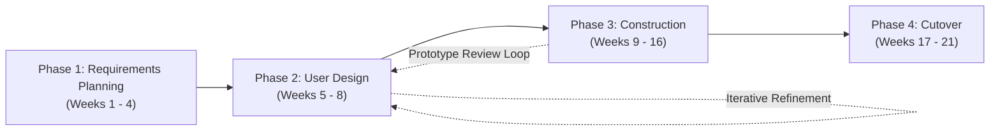
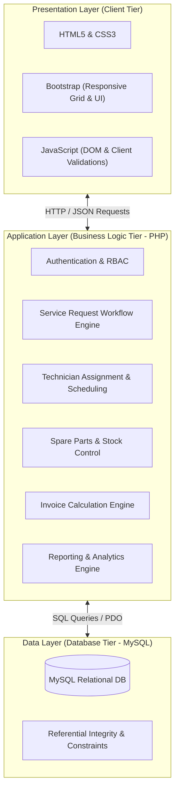

# Development Roadmap: After-Sales Service Information System (ASSIS)

**Project Name:** After-Sales Service Information System (ASSIS)  
**Academic Affiliation:** Mount Kenya University – School of Computing and Informatics, Department of Information Technology  
**Author / Candidate:** Najma Hassan (ADM: BIT/2024/48669)  
**Methodological Framework:** Rapid Application Development (RAD) (Martin, 1991)  
**Architecture:** Three-Tier Architecture (Presentation, Application, Data)  
**Primary Stack:** HTML5, CSS3, JavaScript, Bootstrap | PHP | MySQL (XAMPP Environment)  
**Total Planned Duration:** 21 Weeks  

---

## 1. Executive Summary & Development Model

This roadmap establishes the operational path for the design, development, testing, and deployment of the **After-Sales Service Information System (ASSIS)**. In strict accordance with the proposal document ([sameera.md](./sameera.md)), the project executes under the **Rapid Application Development (RAD)** model. 

RAD is selected over traditional sequential models to accommodate evolving operational nuances through rapid prototyping, iterative module construction, and continuous user involvement (front-desk staff, service technicians, and the service manager).

---

## 2. Project Boundaries & Scope Control

To ensure strict adherence to Section 1.3 of the proposal and prevent scope creep, project boundaries are explicitly defined:

| Scope Dimension | In-Scope (Strictly Included) | Out-of-Scope (Explicitly Excluded) |
|---|---|---|
| **Deployment Target** | Single enterprise operating single or multiple physical service centres | Public cloud SaaS / multi-tenant commercial platforms |
| **User Interfaces** | Internal staff GUI: Reception / Front Desk, Technicians, Service Manager / Admin | Public customer self-service portal |
| **Platform** | Responsive Web Browser Application (HTML5 / Bootstrap) | Native mobile applications (Android / iOS) |
| **Customer & Asset** | Customer registration & direct linkage of purchased products and warranties | External CRM sync / third-party marketing suites |
| **Service Workflow** | Request logging, status lifecycle (`Pending`, `In Progress`, `Completed`, `Closed`), priority levels | AI-based automated diagnostic triage |
| **Technician Management** | Assignment matching specialization & availability; workload tracking | GPS real-time technician fleet tracking |
| **Inventory Control** | Spare parts catalogue, stock deduction via `PARTS_USED`, low-stock alerts | Full supply chain / procurement enterprise suites |
| **Financial Tracking** | Invoicing based on labour charges + parts utilized; payment status (`Unpaid`, `Paid`, `Partially Paid`) | External payment gateway APIs (e.g., M-Pesa, Stripe) & full financial accounting / balance sheets |
| **Feedback & Analytics** | 1–5 star ratings, text comments, management KPI reports | Advanced machine learning sentiment analysis |

---

## 3. Technology Stack & Architectural Baseline

The system strictly adheres to the Three-Tier Architecture specified in Section 5.1 and Table 5.1 of the proposal:

- **Operating & Local Server Environment:** XAMPP (Apache HTTP Server, PHP runtime, MySQL)
- **Code Editor & Source Management:** Visual Studio Code & Git Version Control
- **Modeling & Diagramming:** Draw.io (DFDs, ERDs, Wireframes)

---

## 4. Phase-by-Phase Implementation Roadmap

### Phase 1: Requirements Planning (Weeks 1 – 4)
*Goal: Consolidate organizational requirements, formalize domain research, and establish foundational project baselines.*

```mermaid
gantt
    title Phase 1: Requirements Planning
    dateFormat  X
    axisFormat Week %X
    Topic Selection & Proposal Formulation :0, 2
    Literature Review & Comparative Analysis :1, 3
    Empirical Requirements Gathering (Interviews, Observation, Document Review) :2, 4
    Feasibility, Budget & Risk Assessment :3, 4
```

#### Detailed Work Breakdown:
1. **Empirical Data Gathering (Proposal Section 3.2):**
   - **Interviews:** Conduct structured and semi-structured sessions with front-desk staff, service technicians, and the service manager to document manual pain points.
   - **Direct Observation:** Shadow the physical workflow of customer check-in, repair logging, phone-based technician notification, and manual billing.
   - **Document Review:** Audit historical physical artefacts including paper logbooks, stock bin cards, handwritten customer receipts, and warranty cards.
2. **Literature Review Synthesis (Proposal Chapter 2):**
   - Document research on after-sales service management, CRM principles (Kendall & Kendall, 2014), inventory control in repair environments (Connolly & Begg, 2014), and RAD methodology (Martin, 1991).
   - Formulate the Conceptual Framework linking ASSIS functional modules with service delivery quality metrics.
3. **Risk & Governance Baseline:**
   - Establish Git repository with branch policies.
   - Set up regular local and cloud repository synchronisation to mitigate hardware failure and data loss (Risk Matrix Table 1.1).

#### Key Deliverables:
- Signed-off Requirements Specification Document (Functional & Non-Functional Requirements).
- Consolidated Data Dictionary of legacy paper records.
- Completed Chapter 1, 2, and 3 project documentation.

---

### Phase 2: User Design (Weeks 5 – 8)
*Goal: Transform requirements into concrete logical designs, relational database architectures, and interactive wireframe prototypes through rapid user validation.*

```mermaid
gantt
    title Phase 2: User Design
    dateFormat  X
    axisFormat Week %X
    System Modeling (Context DFD, Level 1 DFD, ERD) :4, 6
    Relational Database Schema Design (DDL & Normalization) :6, 7
    User Interface & Wireframe Prototyping :6, 7
    Stakeholder Prototype Review & Refinement Loops :7, 8
```

#### Detailed Work Breakdown:
1. **System Modeling (Proposal Section 4.2):**
   - **Context Diagram (Level 0):** Model external entities (`Customer`, `Technician`, `Manager / Administrator`, `Supplier`) and data boundaries.
   - **Level 1 Data Flow Diagram (DFD):** Detail processes:
     - 1.0 Customer Registration (`D1: CUSTOMER FILE`)
     - 2.0 Product Registration (`D2: PRODUCT FILE`)
     - 3.0 Service Request Management (`D3: SERVICE REQUEST FILE`)
     - 4.0 Technician Assignment (`D4: TECHNICIAN FILE`)
     - 5.0 Spare Parts Management (`D5: SPARE PART FILE`)
     - 6.0 Invoice Processing (`D6: INVOICE FILE`)
     - 7.0 Customer Feedback (`D7: FEEDBACK FILE`)
     - 8.0 Management Reporting
2. **Relational Database Design (Proposal Section 5.2):**
   - Structure 3NF physical schema across all 10 core tables:
     - `CUSTOMER`, `PRODUCT`, `WARRANTY`, `TECHNICIAN`, `SERVICE_REQUEST`, `SERVICE_RECORD`, `SPARE_PART`, `PARTS_USED`, `INVOICE`, `FEEDBACK`.
   - Define exact keys, types, ENUM states, foreign key cascades, and check constraints (`Rating CHECK (1-5)`).
3. **UI Wireframing & Prototyping (Proposal Section 5.3 & 5.4):**
   - Design low-to-medium fidelity mockups for:
     - Authentication & Login interface with session selection
     - Customer Registration modal/form with contact validation
     - New Service Request Logging interface with dynamic customer/product dropdowns
     - Technician Assignment & Workload Scheduling board
     - Spare Parts Inventory management & Low-Stock alert dashboard
     - Service Record completion & Automated Invoice generation screen
     - Customer Feedback capture dialogue
     - Service Request Status Report & Management Dashboard wireframes
4. **User Design Review Iteration:**
   - Walk through the interactive prototypes with receptionists, technicians, and management.
   - Refine UI form fields, button layouts, and reporting tables based on direct user feedback before code construction begins.

#### Key Deliverables:
- Finalized System Analysis & Design Specification (DFDs, ERD, Schema tables).
- Validated UI wireframes and screen flow diagrams.
- MySQL Schema DDL script ready for construction.

---

### Phase 3: Construction (Weeks 9 – 16)
*Goal: Develop the software system iteratively using PHP, Bootstrap, and MySQL, implementing features module by module with continuous integration and verification.*

```mermaid
gantt
    title Phase 3: Construction (Modular Sprints)
    dateFormat  X
    axisFormat Week %X
    Sprint 1 - Environment & RBAC Foundation :8, 9
    Sprint 2 - Customer, Product & Warranty Registry :9, 10
    Sprint 3 - Service Request & Status Lifecycle :10, 11
    Sprint 4 - Technician Assignment & Workload Engine :11, 12
    Sprint 5 - Spare Parts Inventory & Stock Control :12, 13
    Sprint 6 - Service Recording & Automated Invoicing :13, 14
    Sprint 7 - Feedback Capture & Reporting Engine :14, 15
    Sprint 8 - System Integration & Rapid Polish :15, 16
```

#### Modular Development Breakdown:

#### Sprint 1: Development Baseline & Authentication (Week 9)
- **Database Initialisation:** Execute MySQL DDL to generate database tables, constraints, foreign keys, and indexes on XAMPP.
- **Project Structure:** Establish clean PHP directory hierarchy (`/config`, `/core`, `/models`, `/controllers`, `/views`, `/assets`).
- **Authentication & RBAC:** Implement secure login/logout, password hashing (`password_hash`), session management, and role-based guards:
  - `Admin / Manager`: Unrestricted operational and reporting access.
  - `Reception / Front Desk`: Customer registration, product linking, service request entry, invoice distribution.
  - `Technician`: View assigned jobs, record repair actions, submit parts used.

#### Sprint 2: Customer, Product & Warranty Registry (Week 10)
- **Customer Management:** Full CRUD operations on `CUSTOMER` table (`FullName`, `PhoneNumber` [UNIQUE], `Email`, `PhysicalAddress`).
- **Product Registry:** Form to register products under specific customers (`ProductName`, `Model`, `SerialNumber` [UNIQUE], `PurchaseDate`).
- **Warranty Association:** Link warranty terms to products (`StartDate`, `EndDate`, `Terms`) with automated active/expired indicator.

#### Sprint 3: Service Request Lifecycle Management (Week 11)
- **Request Logging:** Registration form capturing `CustomerID`, `ProductID`, `IssueDescription`, and `Priority` (`Low`, `Medium`, `High`).
- **Status Lifecycle State Machine:** Enforce state transitions:
  $$\text{Pending} \longrightarrow \text{In Progress} \longrightarrow \text{Completed} \longrightarrow \text{Closed}$$
- **Request Search & Filter:** Instant search by ticket ID, customer phone number, product serial number, and status.

#### Sprint 4: Technician Assignment & Workload Scheduling (Week 12)
- **Technician Registry:** Maintenance of technician records (`FullName`, `Specialization`, `Phone`, `Availability`).
- **Assignment Engine:** Dispatch interface allowing supervisors to assign `Pending` requests to available technicians based on product specialization.
- **Technician Workbench:** Filtered view showing technicians their queue of assigned jobs.

#### Sprint 5: Spare Parts Inventory & Stock Control (Week 13)
- **Inventory Catalogue:** CRUD operations for `SPARE_PART` (`PartName`, `QuantityInStock`, `ReorderLevel`, `UnitPrice`).
- **Stock Movement Logging:** Tracking parts inbound additions and parts outbound consumption.
- **Low-Stock Notification Engine:** Automated UI visual alert badges when `QuantityInStock <= ReorderLevel` (default threshold: 5).

#### Sprint 6: Service Recording & Automated Invoicing (Week 14)
- **Repair Completion Recording:** Technician interface to log `ActionsTaken`, `CompletionDate`, and `LabourCost` in `SERVICE_RECORD`.
- **Parts Consumption Mapping:** Associative mapping in `PARTS_USED` (`PartID`, `QuantityUsed`); execute atomic database transaction deducting consumed quantities from `SPARE_PART.QuantityInStock`.
- **Automated Invoice Generation:** Server-side calculation algorithm:
  $$\text{AmountDue} = \text{LabourCost} + \sum (\text{QuantityUsed} \times \text{UnitPrice})$$
- Record creation in `INVOICE` with payment status tracking (`Unpaid`, `Paid`, `Partially Paid`). Printable invoice layout.

#### Sprint 7: Customer Feedback & Reporting Engine (Week 15)
- **Feedback Collection:** Input form capturing `Rating` (1 to 5 integer check) and optional qualitative `Comments` linked to completed `RequestID`.
- **Management Reporting Engine:** Generation of tabular and printable summary reports:
  - Service Request Status Report (Total, Pending, In Progress, Completed, Closed)
  - Technician Workload & Performance Report
  - Spare Parts Inventory & Low-Stock Alerts Report
  - Customer Feedback & Satisfaction Summary Report
  - Service Turnaround Time Analysis Report

#### Sprint 8: System Integration & Review Loop (Week 16)
- Connect all modular endpoints into the master dashboard navigation.
- Conduct RAD user prototype walkthrough with representative users to identify UI friction points, completing final construction refinements.

---

### Phase 4: Cutover (Weeks 17 – 21)
*Goal: Rigorously test the system against all requirements, migrate legacy data, train personnel, deploy to demonstration hosting, and submit final documentation.*

```mermaid
gantt
    title Phase 4: Cutover
    dateFormat  X
    axisFormat Week %X
    Comprehensive Testing & Debugging :16, 18
    Data Conversion & Legacy Record Migration :17, 18
    User Training & Operations Manuals :18, 19
    System Deployment (Hosting & Database) :18, 19
    Post-Deployment Verification & Handover :19, 20
    Final Project Report Writing & Submission :19, 21
```

#### Detailed Work Breakdown:
1. **System Testing & Quality Assurance (Weeks 17 – 18):**
   - **Unit Testing:** Validate isolated PHP functions (invoice total calculator, stock validation guards, rating range validator).
   - **Integration Testing:** Verify end-to-end data integrity across table cascades (Request -> Service Record -> Parts Used -> Stock Deduction -> Invoice).
   - **Security Testing:** Sanitize all SQL queries against injection (PDO prepared statements), protect against XSS (HTML escaping), and verify RBAC session route isolation.
   - **User Acceptance Testing (UAT):** Formal verification with front-desk staff, technicians, and manager against Non-Functional Requirements (Usability, Performance, Reliability, Security, Scalability, Maintainability).
2. **Data Conversion (Week 18):**
   - Cleanse and normalize historical records from physical logbooks and inventory stock cards.
   - Execute migration script populating baseline customer records, active warranties, product catalogue, and initial spare parts stock balances.
3. **User Training & Documentation (Week 19):**
   - Compile comprehensive User Manual for Receptionists and Technicians.
   - Compile System Administrator Guide covering database backup, user account provisioning, and stock reorder configurations.
   - Conduct hands-on role-specific training sessions.
4. **Deployment (Week 19):**
   - Deploy web application to budgeted domain name and hosting server environment (as outlined in Budget Item 3 & 4, Table 1.2).
   - Configure production MySQL database, environment secrets, and automated database backup schedules.
5. **Final Project Documentation & Academic Sign-off (Weeks 20 – 21):**
   - Author Chapter 6 (Implementation, Testing, Results, and Discussion).
   - Author Chapter 7 (Conclusion, Recommendations, and Future Work).
   - Final report compilation, binding, and submission to the School of Computing and Informatics, Mount Kenya University.

---

## 5. Risk Management & Quality Controls

Directly mapping to Table 1.1 of the proposal, the following risk controls are maintained throughout execution:

| Risk Identified in Proposal | Severity | Operational Control & Mitigation Strategy |
|---|---|---|
| **Scope Creep** | High | Strict adherence to Section 1.3 boundaries. Any user requests for external payment gateways, mobile apps, or public customer portals are formally logged into a Future Work backlog. |
| **Data Loss** | High | Git version control for all source code; automated daily MySQL dumps stored locally and mirrored to remote cloud storage. |
| **Inaccurate Requirement Data** | Medium | Triangulation approach maintained: Cross-verification of interview statements against direct workflow observation and paper logbooks. |
| **Framework Skill Limitations** | Medium | Use vanilla PHP and standard Bootstrap 5 without heavy proprietary frameworks, ensuring maintainability within core competencies. |
| **Stakeholder Unavailability** | Medium | Advance interview bookings, asynchronous prototype sign-offs, and temporal milestone buffers built into the 21-week schedule. |
| **Hardware / Power Interruption** | Medium | Cloud-synchronised Git repositories, mirrored development environments, and contingency workstation arrangements. |
| **Late UAT Failure** | High | Adoption of RAD iterative reviews at the conclusion of each construction sprint, ensuring end-user validation before cutover testing. |

---

## 6. Comprehensive 21-Week Master Schedule

| Week | Project Phase | Primary Activities & Milestones | Core Deliverables |
|:---:|:---|:---|:---|
| **W1** | Phase 1: Requirements Planning | Project initiation, topic formalization, problem statement refinement | Approved Project Concept & Objectives |
| **W2** | Phase 1: Requirements Planning | Literature review on ASSIS, CRM, and inventory systems; conceptual framework | Literature Review Draft & Conceptual Framework |
| **W3** | Phase 1: Requirements Planning | Empirical requirements gathering: Interviews with staff and manager, direct observation | Field Interview Notes & Workflow Observation Records |
| **W4** | Phase 1: Requirements Planning | Document review (logbooks, stock cards); feasibility & risk analysis | Requirements Specification & Proposal Sign-off |
| **W5** | Phase 2: User Design | System Analysis: Context DFD (Level 0) and Level 1 Functional DFD modeling | Context Diagram & Level 1 DFDs |
| **W6** | Phase 2: User Design | Conceptual database modeling: Entity Relationship Diagram (ERD) & Normalization | Completed ERD with Cardinalities |
| **W7** | Phase 2: User Design | Physical database design: Table schemas, datatypes, constraints; Initial UI wireframing | Physical MySQL Schema & UI Wireframe Suite |
| **W8** | Phase 2: User Design | Rapid prototyping review session with end users; UI and schema refinement | Approved Prototype & Design Baseline |
| **W9** | Phase 3: Construction | Setup XAMPP, Git repository, create MySQL database; implement RBAC & Login module | Working Database & Authentication Module |
| **W10** | Phase 3: Construction | Module 2: Customer registration, product catalogue, and warranty linkage | Customer & Product Management Module |
| **W11** | Phase 3: Construction | Module 3: Service request logging, issue description, priority, and status workflow | Service Request Tracking Module |
| **W12** | Phase 3: Construction | Module 4: Technician specialization registry, assignment interface, workload board | Technician Assignment Module |
| **W13** | Phase 3: Construction | Module 5: Spare parts catalogue, stock-in/out tracking, low-stock alert triggers | Spare Parts Inventory Module |
| **W14** | Phase 3: Construction | Module 6: Repair action logging, parts consumption mapping, automated invoice generation | Service Record & Billing Engine |
| **W15** | Phase 3: Construction | Module 7 & 8: Customer feedback capture; Management reporting engine & dashboards | Feedback & Reporting Modules |
| **W16** | Phase 3: Construction | Full system module integration, UI polish, edge-case validation, sprint review | Integrated Alpha Build (ASSIS v1.0) |
| **W17** | Phase 4: Cutover | Comprehensive unit testing, integration testing, vulnerability & security checks | Test Execution Logs & Bug Fix Reports |
| **W18** | Phase 4: Cutover | User Acceptance Testing (UAT) with staff; Legacy data conversion from paper logbooks | Signed UAT Matrix & Populated Database |
| **W19** | Phase 4: Cutover | Role-based user training; User & Administrator manual delivery; Production web deployment | User Manual, Admin Guide & Live Deployed System |
| **W20** | Phase 4: Cutover | Post-deployment operational verification; Final project documentation drafting | Chapters 4, 5, and 6 Final Drafts |
| **W21** | Phase 4: Cutover | Academic report binding, final submission, and project defense preparation | Bound Final Project Report & Academic Presentation |

---
*Roadmap formulated in strict conformance with the academic specifications and development models set forth in the proposal document.*
