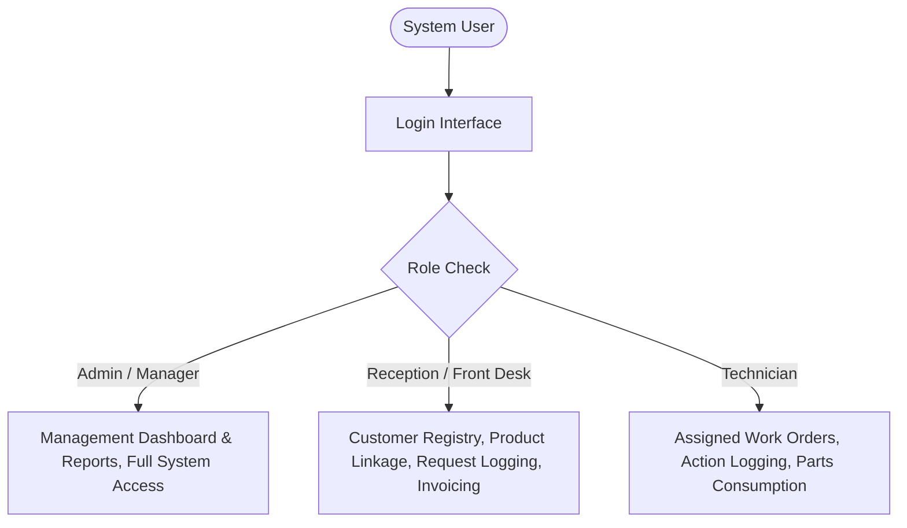
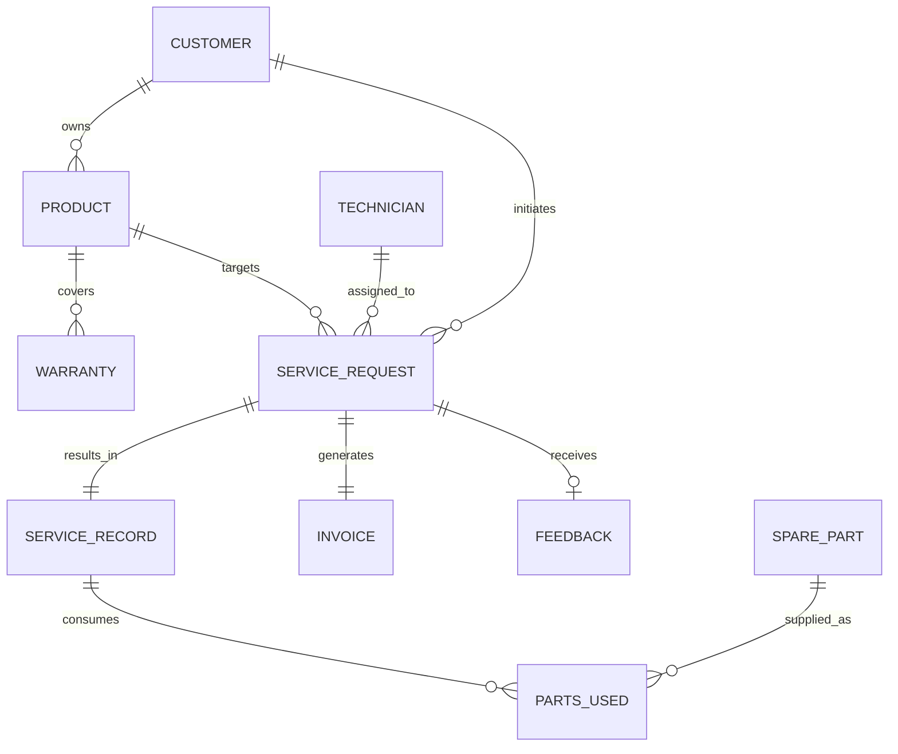
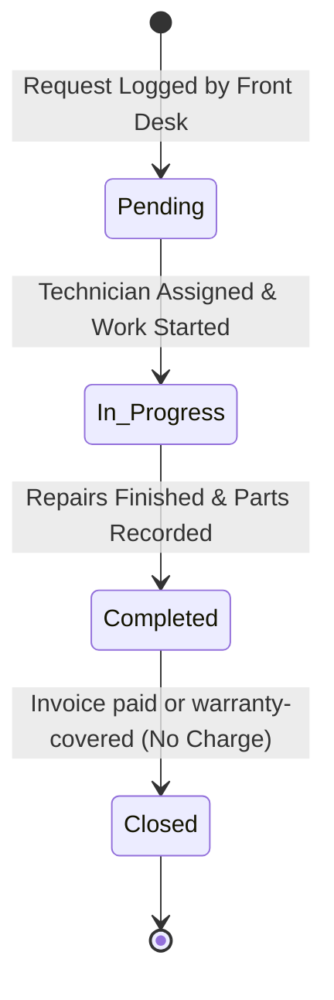

# Technical Specification Document: After-Sales Service Information System (ASSIS)

**Project Name:** After-Sales Service Information System (ASSIS)  
**Author / Candidate:** Najma Hassan (ADM: BIT/2024/48669)  
**Institution:** Mount Kenya University – School of Computing and Informatics  
**Reference Document:** [sameera.md](./sameera.md)  
**Development Methodology:** Rapid Application Development (RAD) (Martin, 1991)  
**Architecture Pattern:** Three-Tier Architecture (Presentation, Application, Data)  

---

## 1. System Overview & Architectural Architecture

The After-Sales Service Information System (ASSIS) is an integrated, database-driven web application designed to replace fragmented manual after-sales processes (paper logbooks, verbal dispatch, manual stock cards, handwritten invoicing) within an enterprise operating single or multiple physical service centres.

### 1.1 Three-Tier Architecture Model

In strict accordance with Section 5.1 of the proposal, the system is structured into three decoupled layers:

```mermaid
graph TD
    subgraph Presentation_Layer ["1. Presentation Layer (Client Tier)"]
        UI_HTML["HTML5 Semantic Markup"]
        UI_CSS["CSS3 & Bootstrap 5 (Responsive Layouts)"]
        UI_JS["JavaScript (Asynchronous Validation & DOM Manipulation)"]
    end

    subgraph Application_Layer ["2. Application Layer (Business Logic Tier - PHP)"]
        AUTH["Authentication & RBAC Middleware"]
        REQ_MGR["Service Request Workflow State Machine"]
        TECH_MGR["Technician Scheduling & Workload Engine"]
        INV_MGR["Spare Parts Inventory & Stock Control"]
        BILL_MGR["Automated Invoicing & Calculation Engine"]
        REP_MGR["Management Reporting Engine"]
    end

    subgraph Data_Layer ["3. Data Layer (Persistence Tier - MySQL)"]
        MYSQL[("MySQL Relational Database")]
        CONSTR["Referential Integrity & Foreign Key Constraints"]
        ACID["Atomic Transactions (Stock Deduction & Invoicing)"]
    end

    Presentation_Layer <-->|HTTP / HTTPS (GET, POST)| Application_Layer
    Application_Layer <-->|PHP PDO (Prepared Statements)| Data_Layer
```

### 1.2 Technology Stack

| Layer / Aspect | Selected Technology | Purpose & Specification |
|---|---|---|
| **Front-End (Presentation)** | HTML5, CSS3, JavaScript, Bootstrap 5 | Responsive UI, input forms, modals, tables, and real-time client validation. |
| **Back-End (Application)** | PHP (8.x) | Request routing, session management, transaction logic, business calculations. |
| **Database (Data)** | MySQL (8.x / MariaDB) | Relational persistence, relational integrity, foreign key cascades, triggers. |
| **Server Runtime** | Apache HTTP Server (XAMPP Environment) | Local web and database execution runtime. |
| **Version Control** | Git | Source code and database migration versioning. |

---

## 2. Scope Boundaries & Constraints

As established in Section 1.3 of [sameera.md](./sameera.md), technical implementation is governed by strict scope boundaries:

- **In-Scope:**
  - Internal administrative, front-desk, and technician interfaces.
  - Customer registry and direct linkage of customer products and warranty terms.
  - Service request logging, assignment, and status lifecycle tracking.
  - Spare parts inventory catalog with automatic deduction on job completion and low-stock reorder alerts.
  - Invoice generation (Labour Cost + Consumed Parts) and status-only payment tracking (`Unpaid`, `Paid`, `Partially Paid`); payment transactions are not recorded.
  - Customer feedback logging (Rating 1–5 and qualitative comments).
  - Tabular management reports (service status, technician workload, inventory balances, feedback).
- **Out-of-Scope (Strictly Excluded):**
  - Public customer self-service web portal.
  - Native mobile applications (Android / iOS).
  - External payment gateway APIs (e.g., M-Pesa, Stripe).
  - Full supply-chain procurement systems beyond stock tracking.
  - Double-entry corporate accounting suites outside service-related invoices.

---

## 3. Actors & Role-Based Access Control (RBAC)

The system enforces strict role-based access control (Section 4.1.1, FR11) to isolate functions according to organizational responsibilities.



### 3.1 Permission Matrix

| Module / Operation | Reception / Front Desk | Technician | Manager / Administrator |
|---|:---:|:---:|:---:|
| **Customer Management (CRUD)** | Read / Write | Read Only | Full Access |
| **Product & Warranty Registration** | Read / Write | Read Only | Full Access |
| **Log New Service Request** | Create / Read | No Access | Full Access |
| **Assign Technician to Request** | No Access | No Access | Full Access |
| **Update Request Status** | Read Only | Update (`In Progress`, `Completed`) | Full Access |
| **Log Repair Actions & Parts Used** | No Access | Create / Write | Full Access |
| **Inventory: View Stock & Alerts** | Read Only | Read Only | Full Access |
| **Inventory: Stock In / Adjust** | No Access | No Access | Full Access |
| **Invoice Generation & Payment Status** | Generate / Read / Update | Read Only | Full Access |
| **Capture Customer Feedback** | Create / Read | Read Only | Full Access |
| **Management Reports & Analytics** | No Access | No Access | Generate / Export / View |
| **User & Technician Account Setup** | No Access | No Access | Full Access |

---

## 4. Database Specification & Schema DDL

The as-built schema is defined by [`database/schema.sql`](./database/schema.sql). Its implementation-derived ERD, full data dictionary, table descriptions, relationship cardinalities, and referential actions are documented in [`DATABASE_DOCUMENTATION.md`](./DATABASE_DOCUMENTATION.md). Use that document as the reference for the current database implementation. The ERD and DDL below are retained only as the original proposal design baseline; they are not the current as-built schema.



### 4.1 Proposal Design Baseline (Not the As-Built Schema)

```sql
-- Database Creation
CREATE DATABASE IF NOT EXISTS `assis_db` DEFAULT CHARACTER SET utf8mb4 COLLATE utf8mb4_unicode_ci;
USE `assis_db`;

-- 1. System Users Table (Supports RBAC & Authentication)
CREATE TABLE `USERS` (
    `UserID` INT AUTO_INCREMENT PRIMARY KEY,
    `Username` VARCHAR(50) NOT NULL UNIQUE,
    `PasswordHash` VARCHAR(255) NOT NULL,
    `FullName` VARCHAR(100) NOT NULL,
    `Role` ENUM('Admin', 'FrontDesk', 'Technician') NOT NULL,
    `RelatedTechnicianID` INT NULL,
    `IsActive` TINYINT(1) DEFAULT 1,
    `CreatedAt` DATETIME DEFAULT CURRENT_TIMESTAMP
) ENGINE=InnoDB;

-- 2. CUSTOMER Table (Table 5.2)
CREATE TABLE `CUSTOMER` (
    `CustomerID` INT AUTO_INCREMENT PRIMARY KEY,
    `FullName` VARCHAR(100) NOT NULL,
    `PhoneNumber` VARCHAR(20) NOT NULL UNIQUE,
    `Email` VARCHAR(100) NULL,
    `PhysicalAddress` VARCHAR(150) NULL,
    `DateRegistered` DATETIME DEFAULT CURRENT_TIMESTAMP
) ENGINE=InnoDB;

-- 3. PRODUCT Table (Table 5.3)
CREATE TABLE `PRODUCT` (
    `ProductID` INT AUTO_INCREMENT PRIMARY KEY,
    `CustomerID` INT NOT NULL,
    `ProductName` VARCHAR(100) NOT NULL,
    `Model` VARCHAR(100) NOT NULL,
    `SerialNumber` VARCHAR(100) NOT NULL UNIQUE,
    `PurchaseDate` DATE NULL,
    CONSTRAINT `fk_product_customer` FOREIGN KEY (`CustomerID`) REFERENCES `CUSTOMER` (`CustomerID`) ON DELETE CASCADE
) ENGINE=InnoDB;

-- 4. WARRANTY Table (Table 5.4)
CREATE TABLE `WARRANTY` (
    `WarrantyID` INT AUTO_INCREMENT PRIMARY KEY,
    `ProductID` INT NOT NULL,
    `StartDate` DATE NOT NULL,
    `EndDate` DATE NOT NULL,
    `Terms` TEXT NULL,
    CONSTRAINT `fk_warranty_product` FOREIGN KEY (`ProductID`) REFERENCES `PRODUCT` (`ProductID`) ON DELETE CASCADE
) ENGINE=InnoDB;

-- 5. TECHNICIAN Table (Table 5.5)
CREATE TABLE `TECHNICIAN` (
    `TechnicianID` INT AUTO_INCREMENT PRIMARY KEY,
    `FullName` VARCHAR(100) NOT NULL,
    `Specialization` VARCHAR(100) NOT NULL,
    `Phone` VARCHAR(20) NULL,
    `Availability` ENUM('Available', 'Busy', 'On Leave') DEFAULT 'Available'
) ENGINE=InnoDB;

-- 6. SERVICE_REQUEST Table (Table 5.6)
CREATE TABLE `SERVICE_REQUEST` (
    `RequestID` INT AUTO_INCREMENT PRIMARY KEY,
    `CustomerID` INT NOT NULL,
    `ProductID` INT NOT NULL,
    `TechnicianID` INT NULL,
    `DateLogged` DATETIME DEFAULT CURRENT_TIMESTAMP,
    `IssueDescription` TEXT NOT NULL,
    `Priority` ENUM('Low', 'Medium', 'High') DEFAULT 'Medium',
    `Status` ENUM('Pending', 'In Progress', 'Completed', 'Closed') DEFAULT 'Pending',
    CONSTRAINT `fk_request_customer` FOREIGN KEY (`CustomerID`) REFERENCES `CUSTOMER` (`CustomerID`),
    CONSTRAINT `fk_request_product` FOREIGN KEY (`ProductID`) REFERENCES `PRODUCT` (`ProductID`),
    CONSTRAINT `fk_request_technician` FOREIGN KEY (`TechnicianID`) REFERENCES `TECHNICIAN` (`TechnicianID`) ON DELETE SET NULL
) ENGINE=InnoDB;

-- 7. SERVICE_RECORD Table (Table 5.7)
CREATE TABLE `SERVICE_RECORD` (
    `RecordID` INT AUTO_INCREMENT PRIMARY KEY,
    `RequestID` INT NOT NULL UNIQUE,
    `ActionsTaken` TEXT NOT NULL,
    `CompletionDate` DATE NULL,
    `LabourCost` DECIMAL(10,2) NOT NULL DEFAULT 0.00,
    CONSTRAINT `fk_record_request` FOREIGN KEY (`RequestID`) REFERENCES `SERVICE_REQUEST` (`RequestID`) ON DELETE CASCADE
) ENGINE=InnoDB;

-- 8. SPARE_PART Table (Table 5.8)
CREATE TABLE `SPARE_PART` (
    `PartID` INT AUTO_INCREMENT PRIMARY KEY,
    `PartName` VARCHAR(100) NOT NULL,
    `QuantityInStock` INT NOT NULL DEFAULT 0,
    `ReorderLevel` INT NOT NULL DEFAULT 5,
    `UnitPrice` DECIMAL(10,2) NOT NULL,
    CONSTRAINT `chk_stock_positive` CHECK (`QuantityInStock` >= 0)
) ENGINE=InnoDB;

-- 9. PARTS_USED Table (Associative Entity, Table 5.9)
CREATE TABLE `PARTS_USED` (
    `PartsUsedID` INT AUTO_INCREMENT PRIMARY KEY,
    `RecordID` INT NOT NULL,
    `PartID` INT NOT NULL,
    `QuantityUsed` INT NOT NULL,
    CONSTRAINT `fk_partsused_record` FOREIGN KEY (`RecordID`) REFERENCES `SERVICE_RECORD` (`RecordID`) ON DELETE CASCADE,
    CONSTRAINT `fk_partsused_part` FOREIGN KEY (`PartID`) REFERENCES `SPARE_PART` (`PartID`),
    CONSTRAINT `chk_qty_positive` CHECK (`QuantityUsed` > 0)
) ENGINE=InnoDB;

-- 10. INVOICE Table (Table 5.10)
CREATE TABLE `INVOICE` (
    `InvoiceID` INT AUTO_INCREMENT PRIMARY KEY,
    `RequestID` INT NOT NULL UNIQUE,
    `AmountDue` DECIMAL(10,2) NOT NULL,
    `WarrantyApplied` TINYINT(1) NOT NULL DEFAULT 0,
    `PaymentStatus` ENUM('Unpaid', 'Paid', 'Partially Paid', 'No Charge') NOT NULL DEFAULT 'Unpaid',
    `DateIssued` DATETIME DEFAULT CURRENT_TIMESTAMP,
    CONSTRAINT `fk_invoice_request` FOREIGN KEY (`RequestID`) REFERENCES `SERVICE_REQUEST` (`RequestID`) ON DELETE CASCADE
) ENGINE=InnoDB;

-- 11. FEEDBACK Table (Table 5.11)
CREATE TABLE `FEEDBACK` (
    `FeedbackID` INT AUTO_INCREMENT PRIMARY KEY,
    `RequestID` INT NOT NULL UNIQUE,
    `Rating` INT NOT NULL,
    `Comments` TEXT NULL,
    `FeedbackDate` DATETIME DEFAULT CURRENT_TIMESTAMP,
    CONSTRAINT `fk_feedback_request` FOREIGN KEY (`RequestID`) REFERENCES `SERVICE_REQUEST` (`RequestID`) ON DELETE CASCADE,
    CONSTRAINT `chk_rating_range` CHECK (`Rating` >= 1 AND `Rating` <= 5)
) ENGINE=InnoDB;
```

---

## 5. Functional Module Specifications & Logic Rules

### 5.1 Service Request Lifecycle Engine
Every service request transitions through a strict sequential state lifecycle:



- **Transition Rules:**
  - `Pending` $\rightarrow$ `In Progress`: Requires valid `TechnicianID` assignment. Updates `TECHNICIAN.Availability` to `'Busy'` if workload threshold reached.
  - `In Progress` $\rightarrow$ `Completed`: Requires `SERVICE_RECORD` creation (recording `ActionsTaken` and `LabourCost`).
  - `Completed` $\rightarrow$ `Closed`: Triggered when the associated invoice is marked `'Paid'` or is fully covered by warranty (`'No Charge'`). Feedback may be recorded after completion.

The implementation stores only each request's current `Status` and `TechnicianID`, plus request and service-record dates. It does not store status-change or assignment/reassignment events, previous values, a user ID for each change, or a timestamp for each change. Therefore, prior statuses, prior assignees, who performed a change, and when it occurred cannot be reconstructed. “Customer service history” means the customer's linked requests and service records only; it is not a full audit trail or status history. The proposal's statement about timestamped records and user attributions is an intended benefit, not a capability currently implemented.

### 5.2 Inventory Deduction & Atomic Transaction
When a technician submits the repair record with spare parts used, the system executes an atomic transaction in MySQL:

$$\text{BEGIN TRANSACTION}$$
1. Insert `SERVICE_RECORD` with `LabourCost` and `ActionsTaken`.
2. For each part specified in `PARTS_USED`:
   - Verify `SPARE_PART.QuantityInStock >= QuantityUsed`.
   - Insert row into `PARTS_USED`.
   - Update `SPARE_PART`:
     $$\text{QuantityInStock} = \text{QuantityInStock} - \text{QuantityUsed}$$
3. Trigger Low-Stock Notification if:
   $$\text{QuantityInStock} \le \text{ReorderLevel}$$
$$\text{COMMIT TRANSACTION}$$

### 5.3 Automated Invoicing Algorithm
In accordance with Section 4.1.1 (FR8), invoices are automatically computed:

$$\text{PartsTotal} = \sum_{i=1}^{n} \left( \text{PARTS\_USED.QuantityUsed}_i \times \text{SPARE\_PART.UnitPrice}_i \right)$$

$$\text{AmountDue} = \text{SERVICE\_RECORD.LabourCost} + \text{PartsTotal}$$

If the service completion date falls within the product's inclusive warranty start and end dates, the system sets `WarrantyApplied = 1`, waives labour and parts, and records `AmountDue = 0` with `PaymentStatus = 'No Charge'`. Otherwise, the calculated amount is committed with default `PaymentStatus = 'Unpaid'`. Warranty terms are stored as free text and are not interpreted; coverage is date-based only.

Payment tracking is status-based only. Staff can change a non-warranty invoice's status to `Unpaid`, `Paid`, or `Partially Paid`, but the system does not record individual payment transactions, amounts received, payment dates, methods, or transaction references. It therefore cannot calculate how much has been paid or remains due. `Partially Paid` is an informational status, not a reconciled partial-payment record. Transaction-level tracking would require a separate `PAYMENT` table and workflow; that is outside the current project scope. `No Charge` is reserved for invoices fully covered by a date-valid warranty.

### 5.4 Management Reporting Engine
In accordance with Section 5.4, the reporting engine generates formatted, tabular data with export/print layouts:
1. **Service Request Status Report:** Summarizes total tickets grouped by `Status` (`Total`, `Pending`, `In Progress`, `Completed`, `Closed`) within selectable date ranges.
2. **Technician Workload Report:** Metrics per technician: Active tickets, completed repairs, mean turnaround time, and utilization.
3. **Inventory & Low-Stock Alerts Report:** Active parts catalogue displaying `QuantityInStock`, `ReorderLevel`, and flagging items where $\text{QuantityInStock} \le \text{ReorderLevel}$.
4. **Customer Feedback & Satisfaction Summary:** Mean satisfaction score computed from `Rating` (1 to 5), distribution counts, and customer feedback logs.

---

## 6. User Interface & Input/Output Design

In accordance with Section 5.3 and Figures 5.2–5.5 in [sameera.md](./sameera.md):

| Screen / Interface | Target Role | Key Input Controls & Validations | Output Generated |
|---|---|---|---|
| **Login Interface (Fig 5.2)** | All Users | Username, Password, Role selector | Session token, redirect to role dashboard |
| **Customer Registration (Fig 5.3)** | Front Desk / Admin | FullName (text), PhoneNumber (regex, unique), Email, PhysicalAddress | Created Customer ID, Customer Profile |
| **New Service Request (Fig 5.4)** | Front Desk / Admin | Customer Search, Product Dropdown, IssueDescription (textarea), Priority (select) | Ticket Number (RequestID), Printable Job Slip |
| **Technician Workbench** | Technician | ActionsTaken (textarea), LabourCost (decimal), Spare Parts Multi-Select & Quantity | Service Record, Stock deduction receipt |
| **Invoicing Screen** | Front Desk / Admin | Request ID selector, Payment Status toggle (`Unpaid`, `Paid`, `Partially Paid`); no payment amount or transaction entry | Formatted Printable Service Invoice |
| **Customer Feedback Form** | Front Desk / Customer | Rating (1 to 5 star radio/select), Comments (textarea) | Feedback acknowledgement |
| **Status Report Screen (Fig 5.5)** | Manager / Admin | Date range filter (`StartDate`, `EndDate`) | Tabular Report & Printable Summary Sheet |

---

## 7. Security & Non-Functional Specifications

Directly satisfying Section 4.1.2 of the proposal:

1. **Authentication & Session Security:**
   - Password hashing using PHP `password_hash()` with `PASSWORD_BCRYPT`; new and reset passwords require at least 8 characters and no more than 72 bytes.
   - Login attempts are limited to five failures per normalized username or client IP per 15-minute window.
   - Session IDs use strict mode and cookie-only transport. Session cookies use `HttpOnly` and `SameSite=Lax`, and are marked `Secure` over HTTPS or when `APP_ENV=production`.
   - Production deployment requires HTTPS; reverse-proxy deployments must configure `APP_ENV=production`.
2. **SQL Injection Defense:**
   - Universal implementation of PHP Data Objects (PDO) with strict parameterized prepared statements. Zero dynamic raw query concatenation.
3. **Cross-Site Scripting (XSS) Prevention:**
   - HTML sanitization via `htmlspecialchars($input, ENT_QUOTES, 'UTF-8')` on all rendered output.
4. **Data Integrity & Consistency:**
   - Foreign key constraints with `RESTRICT` or `CASCADE` rules enforcing relational health.
   - Database level check constraints (`CHECK (Rating BETWEEN 1 AND 5)` and `CHECK (QuantityInStock >= 0)`).
5. **Maintainability & Code Structure:**
   - Modular MVC-inspired file structure separating view templates (`/views`), business controllers (`/controllers`), database models (`/models`), and shared utilities (`/config`).

---

*Specification derived faithfully from the After-Sales Service Information System Proposal ([sameera.md](./sameera.md)).*
